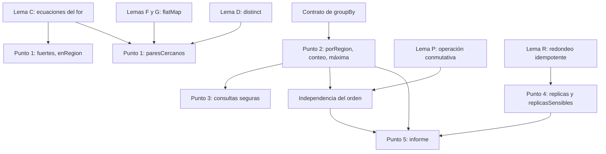
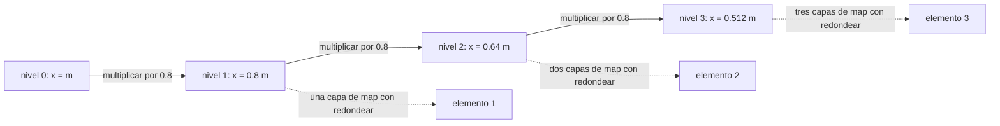
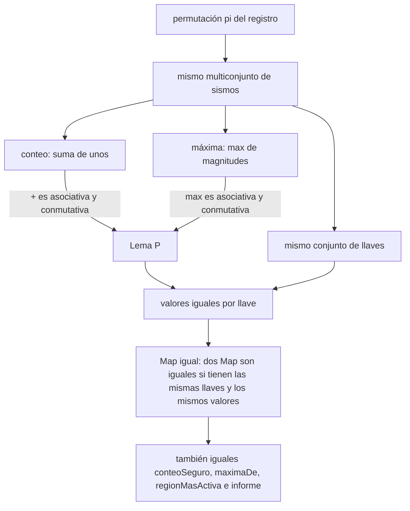

# Informe de corrección: consultas sobre un registro sísmico

Este informe argumenta que cada función del taller hace lo que el enunciado pide. Los programas sobre listas se demuestran por **inducción estructural** sobre el registro (caso base: registro vacío; paso de inducción: se añade un sismo al frente). La secuencia perezosa del punto 4 se argumenta por inducción sobre la posición $n$ del elemento, y la propiedad se enuncia sobre los primeros $n$ elementos, no sobre toda la secuencia. Al final se demuestra que los agrupamientos **no dependen del orden** en que se recorre el registro.



## 0. Notación y lemas

Para un sismo $s$ escribimos $\rho(s)$ para su región y $\mu(s)$ para su magnitud. Un registro es una lista $r = \mathrm{Nil}$ o $r = s :: r'$. Para una región $k$ definimos el **grupo** de $k$ en $r$ como la sublista de los sismos de esa región, en el orden de $r$:

$$G_k(r) = [\, s \mid s \leftarrow r,\ \rho(s) = k \,]$$

y el conjunto de regiones de $r$ como $\mathrm{Reg}(r) = \{\, \rho(s) \mid s \in r \,\}$. Observe que $k \in \mathrm{Reg}(r) \iff G_k(r) \neq \mathrm{Nil}$.

### Lema C (ecuaciones de un `for` con filtro)

Para un `for` de un generador con filtro escribimos $[\, e(s) \mid s \leftarrow r,\ p(s) \,]$. Como el `for` se traduce a `withFilter` y `map` (ver `proceso.md`), y estas operaciones recorren la lista de izquierda a derecha, se cumplen las ecuaciones:

$$[\, e(s) \mid s \leftarrow \mathrm{Nil},\ p(s) \,] = \mathrm{Nil}$$

$$[\, e(s) \mid s \leftarrow x :: r',\ p(s) \,] = \begin{cases} e(x) :: [\, e(s) \mid s \leftarrow r',\ p(s) \,] & \text{si } p(x) \\ [\, e(s) \mid s \leftarrow r',\ p(s) \,] & \text{si } \neg p(x) \end{cases}$$

### Lema F (ecuaciones de `flatMap`)

$$\mathrm{flatMap}(h, \mathrm{Nil}) = \mathrm{Nil} \qquad \mathrm{flatMap}(h, y :: ys) = h(y) \mathbin{+\!+} \mathrm{flatMap}(h, ys)$$

### Lema G (un generador que no es el último)

Sea $ys = [y_1, \ldots, y_p]$ y $h$ una función que devuelve listas. Entonces $\mathrm{flatMap}(h, ys) = h(y_1) \mathbin{+\!+} h(y_2) \mathbin{+\!+} \cdots \mathbin{+\!+} h(y_p)$: las listas de cada elemento, concatenadas en el orden de $ys$.

*Demostración.* Por inducción sobre $p$. Para $p = 0$ es $\mathrm{Nil}$, por el Lema F. Para $p + 1$, el Lema F da $h(y_1) \mathbin{+\!+} \mathrm{flatMap}(h, [y_2, \ldots])$, y la hipótesis de inducción completa la concatenación. $\blacksquare$

### Lema D (`distinct`)

`distinct` conserva la **primera** ocurrencia de cada elemento y elimina las siguientes, sin alterar el orden. En particular, si una lista es la concatenación de bloques $B_1 \mathbin{+\!+} \cdots \mathbin{+\!+} B_t$, donde cada bloque repite un único valor $e_i$ (posiblemente cero veces) y los $e_i$ son **distintos entre sí**, entonces $\mathrm{distinct}$ de esa lista es $[\, e_i \mid B_i \neq \mathrm{Nil} \,]$, en el orden de los bloques.

### Lema P (operación asociativa y conmutativa)

Sea $\oplus$ una operación **asociativa y conmutativa** sobre un conjunto $M$, sea $g$ una función y sea $F(r) = g(s_1) \oplus g(s_2) \oplus \cdots \oplus g(s_n)$ para $r = [s_1, \ldots, s_n]$, $n \geq 1$. Entonces, para toda permutación $\pi$ de $r$, $F(\pi(r)) = F(r)$.

*Demostración.* Basta mostrar que intercambiar dos elementos **adyacentes** no cambia $F$, porque toda permutación se obtiene como una sucesión finita de intercambios adyacentes (es lo que hace, por ejemplo, el ordenamiento de burbuja). Sea $a = g(s_i)$, $b = g(s_{i+1})$, y sean $x$ el resultado de combinar con $\oplus$ todo lo que está antes de ellos e $y$ lo que está después (cualquiera de los dos puede faltar). Por asociatividad no importa cómo se agrupe, y por conmutatividad:

$$x \oplus a \oplus b \oplus y = x \oplus b \oplus a \oplus y$$

Luego $F$ no cambia. Aplicando esto tantas veces como intercambios requiera $\pi$, $F(\pi(r)) = F(r)$. $\blacksquare$

### Lema R (el redondeo es idempotente)

Sea $\mathrm{red}(y) = \dfrac{\mathrm{round}(100\, y)}{100}$ el redondeo a dos decimales (`redondear`). Entonces $\mathrm{red}(\mathrm{red}(y)) = \mathrm{red}(y)$, y $\mathrm{red}$ es monótona: si $y \leq z$ entonces $\mathrm{red}(y) \leq \mathrm{red}(z)$.

*Demostración.* Sea $k = \mathrm{round}(100\, y) \in \mathbb{Z}$, de modo que $\mathrm{red}(y) = k / 100$. Entonces $100 \cdot (k/100) = k$, que ya es entero, así que $\mathrm{round}$ lo deja igual y $\mathrm{red}(k/100) = k/100$. La monotonía se sigue de que $\mathrm{round}$ es monótona y multiplicar o dividir por $100$ conserva el orden. En `Double`, $100 \cdot (k/100)$ puede diferir de $k$ en una fracción diminuta (del orden de $10^{-14}$), muy lejos de $0.5$, así que $\mathrm{round}$ devuelve el mismo $k$. $\blacksquare$

---

## 1. Punto 1: consultas con expresiones `for`

### 1.1 `fuertes`

**Especificación.** $f_u(r)$ es la lista de las regiones de los sismos con magnitud mayor que $u$, en el orden de $r$ y sin quitar repetidos. Formalmente, por recursión sobre $r$:

$$f_u(\mathrm{Nil}) = \mathrm{Nil} \qquad f_u(s :: r') = \begin{cases} \rho(s) :: f_u(r') & \text{si } \mu(s) > u \\ f_u(r') & \text{si } \mu(s) \leq u \end{cases}$$

**Programa.** $P_f(r, u) = [\, \rho(s) \mid s \leftarrow r,\ \mu(s) > u \,]$ (el `for` de `fuertes`).

**Teorema.** $\forall r \in \mathrm{Registro} : P_f(r, u) = f_u(r)$.

**Caso base:** $r = \mathrm{Nil}$.

$$P_f(\mathrm{Nil}, u) = [\, \rho(s) \mid s \leftarrow \mathrm{Nil},\ \mu(s) > u \,] \rightarrow \mathrm{Nil}$$

Por otro lado, $f_u(\mathrm{Nil}) = \mathrm{Nil}$. Entonces $P_f(\mathrm{Nil}, u) = f_u(\mathrm{Nil})$.

**Caso de inducción:** $r = s :: r'$. Hay que demostrar $P_f(r', u) = f_u(r') \rightarrow P_f(s :: r', u) = f_u(s :: r')$. Por el Lema C hay dos casos:

- Si $\mu(s) > u$: $P_f(s :: r', u) = \rho(s) :: P_f(r', u) \overset{\text{HI}}{=} \rho(s) :: f_u(r') = f_u(s :: r')$.
- Si $\mu(s) \leq u$: $P_f(s :: r', u) = P_f(r', u) \overset{\text{HI}}{=} f_u(r') = f_u(s :: r')$.

Concluimos por inducción que $\forall r : P_f(r, u) = f_u(r)$. $\blacksquare$

**Consecuencias que pide el enunciado.** El resultado conserva repetidos (nunca se llama a `distinct`) y respeta el orden del registro (cada paso agrega al frente de lo que ya devolvió la cola). Además, la longitud de $f_u(r)$ es exactamente el número de sismos con $\mu(s) > u$.

### 1.2 `enRegion`

**Especificación.** $e_k(r)$ es la lista de las magnitudes de los sismos de la región $k$, en el orden de $r$, es decir, por recursión:

$$e_k(\mathrm{Nil}) = \mathrm{Nil} \qquad e_k(s :: r') = \begin{cases} \mu(s) :: e_k(r') & \text{si } \rho(s) = k \\ e_k(r') & \text{si } \rho(s) \neq k \end{cases}$$

**Programa.** $P_f(r, k) = [\, \mu(s) \mid s \leftarrow r,\ \rho(s) = k \,]$.

**Teorema.** $\forall r : P_f(r, k) = e_k(r)$.

**Caso base:** $r = \mathrm{Nil}$. Por el Lema C, $P_f(\mathrm{Nil}, k) = \mathrm{Nil} = e_k(\mathrm{Nil})$.

**Caso de inducción:** $r = s :: r'$. Por el Lema C, si $\rho(s) = k$ entonces $P_f(s :: r', k) = \mu(s) :: P_f(r', k) \overset{\text{HI}}{=} \mu(s) :: e_k(r') = e_k(s :: r')$; si $\rho(s) \neq k$ entonces $P_f(s :: r', k) = P_f(r', k) \overset{\text{HI}}{=} e_k(r') = e_k(s :: r')$.

Concluimos por inducción que $\forall r : P_f(r, k) = e_k(r)$. En particular, si $k \notin \mathrm{Reg}(r)$ ningún sismo cumple el filtro y el resultado es $\mathrm{Nil}$ (`List()`), como pide el ejemplo de `"Amazonas"`. $\blacksquare$

### 1.3 `paresCercanos`

**Especificación.** Sea $R = [g_0, g_1, \ldots, g_{m-1}]$ la lista de regiones de $r$ **sin repetir**, en orden de primera aparición. Sea $d \geq 0$ la diferencia permitida y

$$C(a, b) \equiv \exists\, s, t \in r : \rho(s) = a \ \land\ \rho(t) = b \ \land\ |\mu(s) - \mu(t)| \leq d$$

El resultado esperado es

$$f_d(r) = [\, (g_i, g_j) \mid 0 \leq i < j < m,\ C(g_i, g_j) \,]$$

en orden lexicográfico de $(i, j)$. Esto expresa: parejas de regiones distintas, cada pareja una sola vez, sin importar el orden, con las regiones en el orden en que aparecen en el registro.

**Programa.**

```scala
val regiones = (for { sismo <- r } yield sismo.region).distinct
(for {
  (region1, indice1) <- regiones.zipWithIndex
  (region2, indice2) <- regiones.zipWithIndex
  if indice1 < indice2
  sismo1 <- r if sismo1.region == region1
  sismo2 <- r if sismo2.region == region2
  if math.abs(sismo1.magnitud - sismo2.magnitud) <= dif
} yield (region1, region2)).distinct
```

**Paso 1: `regiones` es $R$.** El `for` sin filtro es $[\, \rho(s) \mid s \leftarrow r \,]$, las regiones de cada sismo en orden. Por el Lema D, `distinct` conserva la primera ocurrencia de cada una, así que el resultado no tiene repetidos y queda en orden de primera aparición: es $R$. Entonces `regiones.zipWithIndex` es $[(g_0, 0), \ldots, (g_{m-1}, m-1)]$.

**Paso 2: cuántas veces se emite cada pareja.** Fijadas las posiciones $i < j$, los dos generadores de sismos recorren $G_{g_i}(r)$ y $G_{g_j}(r)$ (el `if` de cada uno es el filtro por región, Lema C). Sea

$$w(i, j) = \big|\, [\, (s, t) \mid s \leftarrow G_{g_i}(r),\ t \leftarrow G_{g_j}(r),\ |\mu(s) - \mu(t)| \leq d \,] \,\big|$$

el número de combinaciones de sismos que cumplen. Por definición de $C$, $w(i, j) > 0 \iff C(g_i, g_j)$. El cuerpo del `for` emite $(g_i, g_j)$ exactamente una vez por cada una de esas combinaciones, así que para $(i, j)$ emite un bloque $B(i, j)$ formado por $w(i, j)$ copias de $(g_i, g_j)$. Esto se ve aplicando el Lema G al generador de `sismo1` (sobre $G_{g_i}(r)$) y a su vez el Lema C al de `sismo2`.

**Paso 3: el orden de los bloques.** Aplicamos el Lema G a los otros dos generadores que no son el último. El generador de `(region2, indice2)` (con el filtro $i < j$ aplicado por el Lema C) produce, para cada $i$, la concatenación de los bloques $B(i, j)$ con $j > i$, en orden creciente de $j$. El generador de `(region1, indice1)` concatena estas listas en orden creciente de $i$. Por lo tanto, antes del `distinct` la lista es

$$B(0, 1) \mathbin{+\!+} B(0, 2) \mathbin{+\!+} \cdots \mathbin{+\!+} B(m-2, m-1)$$

es decir, los bloques de todas las parejas $i < j$ en orden lexicográfico.

**Paso 4: el `distinct`.** Como las $g_i$ son distintas entre sí, parejas de índices distintas $(i, j) \neq (i', j')$ dan elementos distintos $(g_i, g_j) \neq (g_{i'}, g_{j'})$. Por el Lema D, `distinct` deja una sola copia de cada bloque no vacío, en el orden de los bloques:

$$[\, (g_i, g_j) \mid i < j,\ w(i, j) > 0 \,] = [\, (g_i, g_j) \mid i < j,\ C(g_i, g_j) \,] = f_d(r)$$

Concluimos que el programa devuelve $f_d(r)$. $\blacksquare$

**Propiedades que pide el enunciado.**

1. *Sin parejas de una región consigo misma:* exigimos $i < j$, así que $i \neq j$ y, como las $g$ son distintas, $g_i \neq g_j$.
2. *Cada pareja sale una sola vez y no sale invertida:* para $a \neq b$ regiones de $r$, existen índices únicos $i, j$ con $a = g_i$, $b = g_j$. Sale el par $(a, b)$ solo si $i < j$ y sale $(b, a)$ solo si $j < i$; las dos condiciones no pueden cumplirse a la vez. Las copias repetidas que emite el `for` (cuando $w(i, j) > 1$) las elimina el `distinct`.
3. *Completitud:* $C$ es simétrica, porque $|\mu(s) - \mu(t)| = |\mu(t) - \mu(s)|$ (se intercambian los papeles de $s$ y $t$). Entonces, si $a \neq b$ y existe algún par de sismos que los acerca, $C(a, b)$ y $C(b, a)$ se cumplen a la vez, y se emite el par con la región de menor índice primero.
4. *Orden:* los pares salen en orden lexicográfico de $(i, j)$, es decir, con las regiones en el orden en que aparecen en el registro.

**Nota sobre punto flotante.** La condición $\leq d$ se evalúa sobre `Double`. Puede haber diferencias que en decimales valen exactamente $d$ (por ejemplo $5.3 - 4.7 = 0.6$ cuando $d = 0.6$) y que en `Double` caen a un lado u otro del borde. En el registro del enunciado esto no cambia ninguna respuesta, porque la pareja de regiones afectada (Valle y Santander) ya queda decidida por otras combinaciones de sismos con diferencia claramente menor que $d$.

---

## 2. Punto 2: agrupar con mapas

### 2.1 `porRegion`

**Especificación.** $\mathrm{porRegion}(r)$ es el mapa que a cada región $k \in \mathrm{Reg}(r)$ le asigna $G_k(r)$, y que no tiene más llaves que esas.

**Programa.** `r.groupBy(_.region)`. Su contrato en la biblioteca estándar es: recorre la colección una vez, en orden, y agrega cada elemento al final de la lista de su llave.

**Argumento con estado, invariante y transformación** (como en el ejemplo iterativo de la guía):

- Estado: $(i, M)$, donde $i$ es el número de sismos ya procesados y $M$ es el mapa construido hasta ese punto.
- Estado inicial: $s_0 = (0, \text{mapa vacío})$.
- Estado final: $i = n = |r|$.
- Invariante:

$$\mathrm{Inv}(i, M) \equiv \mathrm{dom}(M) = \mathrm{Reg}(r[1..i]) \ \land\ \forall k \in \mathrm{dom}(M) : M(k) = G_k(r[1..i])$$

donde $r[1..i]$ son los primeros $i$ sismos.
- Transformación: $\mathrm{transformar}(i, M)$ toma el sismo $s_{i+1}$ y lo agrega al **final** de $M(\rho(s_{i+1}))$ (creando la llave si no existía).

**1.** $\mathrm{Inv}(s_0)$: con $i = 0$, $r[1..0] = \mathrm{Nil}$, el dominio de $M$ es vacío y no hay llaves que comprobar. Se cumple.

**2.** $\mathrm{Inv}(i, M) \rightarrow \mathrm{Inv}(\mathrm{transformar}(i, M))$: sea $k_0 = \rho(s_{i+1})$. Para $k \neq k_0$, $G_k(r[1..i+1]) = G_k(r[1..i])$ y $M(k)$ no cambia. Para $k_0$, $G_{k_0}(r[1..i+1]) = G_{k_0}(r[1..i]) \mathbin{+\!+} [s_{i+1}]$, que es exactamente lo que hace la transformación. El dominio gana $k_0$, igual que $\mathrm{Reg}(r[1..i+1]) = \mathrm{Reg}(r[1..i]) \cup \{k_0\}$.

**3.** $\mathrm{Inv}(s_f)$ con $i = n$ da $M(k) = G_k(r)$ y $\mathrm{dom}(M) = \mathrm{Reg}(r)$, que es la especificación.

**4.** Terminación: el contador $i$ sube en cada paso y el registro es finito, así que se alcanza $i = n$ en $n$ pasos.

Por lo tanto, $\mathrm{porRegion}(r)$ cumple la especificación. Una región que no está en $r$ no está en el dominio. $\blacksquare$

### 2.2 `conteoPorRegion`

**Especificación.** $\mathrm{conteo}(r)(k) = |G_k(r)|$ para cada $k \in \mathrm{Reg}(r)$, y no hay otras llaves.

**Programa.** `porRegion(r).map { case (region, sismos) => region -> sismos.length }`.

*Demostración.* `Map.map` aplica la función a cada entrada, sin agregar ni quitar llaves (las llaves son distintas, así que no hay colisiones). Por 2.1, las llaves son $\mathrm{Reg}(r)$ y el valor de $k$ es $G_k(r)$. Aplicar `length` da $|G_k(r)|$. Para $r = \mathrm{Nil}$, $\mathrm{Reg}(r) = \emptyset$ y el resultado es `Map()`. $\blacksquare$

### 2.3 `magnitudMaxima`

**Especificación.** $\mathrm{max}(r)(k) = \max\{\, \mu(s) \mid s \in r,\ \rho(s) = k \,\}$ para cada $k \in \mathrm{Reg}(r)$.

**Programa.** `porRegion(r).map { case (region, sismos) => region -> sismos.map(_.magnitud).max }`.

*Demostración.* Por 2.1, la llave $k$ está en el mapa si y solo si $G_k(r) \neq \mathrm{Nil}$, así que la lista sobre la que se llama `max` **nunca es vacía** y `max` está definido (no lanza excepción). Las magnitudes de esa lista son exactamente $\{\mu(s) \mid s \in r, \rho(s) = k\}$, y `max` devuelve su máximo. $\blacksquare$

---

## 3. Punto 3: consultas seguras

### 3.1 `conteoSeguro`

**Especificación.** Para toda cadena $k$, $\mathrm{conteoSeguro}(r)(k) = |G_k(r)|$, que es $0$ si $k \notin \mathrm{Reg}(r)$.

*Demostración.* `withDefaultValue(0)` devuelve un mapa $M'$ tal que $M'(k) = M(k)$ si $k \in \mathrm{dom}(M)$ y $M'(k) = 0$ en otro caso. Con $M = \mathrm{conteo}(r)$ y por 2.2: si $k \in \mathrm{Reg}(r)$, $M'(k) = |G_k(r)|$; si $k \notin \mathrm{Reg}(r)$, $M'(k) = 0 = |G_k(r)|$ porque $G_k(r) = \mathrm{Nil}$. En ningún caso se lanza excepción. $\blacksquare$

### 3.2 `maximaDe`

**Especificación.** $\mathrm{maximaDe}(r, k) = \mathrm{Some}(m)$, con $m$ la magnitud máxima de la región $k$, si $k \in \mathrm{Reg}(r)$, y $\mathrm{None}$ si no hay registros de $k$.

*Demostración.* `Map.get(k)` devuelve $\mathrm{Some}(M(k))$ si $k \in \mathrm{dom}(M)$ y $\mathrm{None}$ si no. Con $M = \mathrm{magnitudMaxima}(r)$ y por 2.3, $\mathrm{dom}(M) = \mathrm{Reg}(r)$ y $M(k)$ es el máximo de la región. $\blacksquare$

### 3.3 `regionMasActiva`

**Especificación.** Si $r = \mathrm{Nil}$, el resultado es $\mathrm{None}$. Si no, es $\mathrm{Some}(k^*)$ donde $k^*$ cumple $|G_{k^*}(r)| \geq |G_k(r)|$ para toda región $k$, y si hay empate, $k^*$ es la menor en orden alfabético entre las empatadas.

**Programa.**

```scala
if (r.isEmpty) None
else {
  val conteos = conteoPorRegion(r)
  val (masActiva, _) = conteos.minBy { case (region, conteo) => (-conteo, region) }
  Some(masActiva)
}
```

*Demostración.* Si $r = \mathrm{Nil}$, la condición `r.isEmpty` es verdadera y el resultado es $\mathrm{None}$, sin llamar a `minBy` (que lanzaría excepción sobre un mapa vacío). Si $r \neq \mathrm{Nil}$, entonces $\mathrm{Reg}(r) \neq \emptyset$ y, por 2.2, `conteos` tiene al menos una entrada, así que `minBy` está definido.

`minBy` devuelve la entrada cuya llave $(-n, k)$ es mínima en el orden lexicográfico de pares (primero el entero, luego la cadena). Ese orden se traduce en $\prec$ sobre las entradas:

$$(k, n) \prec (k', n') \iff n > n' \ \lor\ (n = n' \land k < k')$$

Como las llaves de un mapa son distintas, dos entradas distintas siempre son comparables: si $n \neq n'$ decide el conteo y si $n = n'$ las regiones difieren y decide el orden alfabético. Entonces $\prec$ es un orden **total estricto** sobre las entradas, y el mínimo es único: es la entrada con el mayor conteo y, entre las de mayor conteo, la de menor nombre alfabético. Esa es $k^*$. $\blacksquare$

---

## 4. Punto 4: réplicas perezosas

### 4.1 Qué se afirma y qué no

La secuencia $\mathrm{replicas}(m)$ es infinita, así que **no se puede afirmar una propiedad sobre "toda" la secuencia como un valor ya construido**. Lo que se demuestra es que *cada elemento, cuando se pide, tiene el valor correcto*: para todo $n \geq 0$, el elemento $n$ es el que dice la especificación, y obtenerlo requiere evaluar un número finito de celdas.

**Notación.** $\mathrm{red}$ es `redondear` (Lema R). Para una secuencia $t$ escribimos $t(n)$ para su elemento en la posición $n$ (empezando en $0$).

**Especificación.** Sea $m$ la magnitud inicial, y $a_n = \mathrm{red}(m \cdot 0.8^{\,n})$ el valor esperado de la réplica $n$. Suponemos:

- **(H1)** $m > 0$ y $m$ tiene a lo sumo dos decimales (como todas las magnitudes del registro), de modo que $\mathrm{red}(m) = m$ y por lo tanto $a_0 = m$.

**Programa.** `replicas(x) = x #:: replicas(x * 0.8).map(redondear)`.

El argumento se hace en aritmética real. La diferencia con `Double` es del orden de $10^{-16}$ relativo por multiplicación, y solo podría importar si $100 \cdot m \cdot 0.8^{\,n}$ cayera casi exactamente en un valor terminado en $.5$.

### 4.2 Lemas sobre secuencias perezosas

**Lema S.** Para una secuencia perezosa se cumple: $(x \mathbin{\#::} t)(0) = x$; $(x \mathbin{\#::} t)(n + 1) = t(n)$; y $(t.\mathrm{map}(f))(n) = f(t(n))$.

Son las ecuaciones que definen `#::` y `map` (el `map` aplica `f` a cada elemento y conserva las posiciones).

### 4.3 Valor de cada elemento

**Teorema.** Para todo $x$ real: $\mathrm{replicas}(x)(0) = x$ y, para todo $n \geq 1$, $\mathrm{replicas}(x)(n) = \mathrm{red}(x \cdot 0.8^{\,n})$.

**Caso base** ($n = 0$): por el Lema S, $\mathrm{replicas}(x)(0) = x$.

**Caso $n = 1$:** por el Lema S,

$$\mathrm{replicas}(x)(1) = \big(\mathrm{replicas}(0.8x).\mathrm{map}(\mathrm{red})\big)(0) = \mathrm{red}\big(\mathrm{replicas}(0.8x)(0)\big) = \mathrm{red}(0.8x)$$

**Caso de inducción:** $n + 1$ con $n \geq 1$. Hipótesis de inducción (HI): para todo $x'$, $\mathrm{replicas}(x')(n) = \mathrm{red}(x' \cdot 0.8^{\,n})$. Por el Lema S:

$$\mathrm{replicas}(x)(n + 1) = \big(\mathrm{replicas}(0.8x).\mathrm{map}(\mathrm{red})\big)(n) = \mathrm{red}\big(\mathrm{replicas}(0.8x)(n)\big)$$

Aplicando la HI con $x' = 0.8x$:

$$\overset{\text{HI}}{=} \mathrm{red}\big(\mathrm{red}(0.8x \cdot 0.8^{\,n})\big) \overset{\text{Lema R}}{=} \mathrm{red}\big(x \cdot 0.8^{\,n+1}\big)$$

Concluimos por inducción que el elemento $n$ de $\mathrm{replicas}(x)$ es $\mathrm{red}(x \cdot 0.8^{\,n})$ para $n \geq 1$. $\blacksquare$

**Consecuencia.** Con (H1), $\mathrm{replicas}(m)(0) = m = a_0$ y $\mathrm{replicas}(m)(n) = a_n$ para $n \geq 1$. Es decir, $\forall n \geq 0 : \mathrm{replicas}(m)(n) = a_n$. Si $m$ tuviera más de dos decimales, el elemento $0$ sería $m$ sin redondear; en `replicasSensibles` el `map(redondear)` final se encarga de redondearlo.

El factor es el $0.8$ del enunciado, y el estado de cada nivel de recursión es $(n, x)$ con $x = m \cdot 0.8^{\,n}$: empieza en $(0, m)$ y cada nivel pasa a $(n + 1, 0.8x)$, que mantiene el invariante $x = m \cdot 0.8^{\,n}$ porque $0.8 \cdot m \cdot 0.8^{\,n} = m \cdot 0.8^{\,n+1}$.

### 4.4 Por qué `take(4)` termina

La cola de `#::` se recibe por nombre y no se evalúa hasta que se fuerza, y `LazyList.map` es perezoso. Obtener el elemento $n$ requiere forzar las colas de las celdas $0, \ldots, n - 1$ y las capas de `map` que las envuelven. Por inducción sobre $n$: el elemento $0$ requiere una celda; para $n \geq 1$, el elemento $n$ de `x #:: replicas(0.8 * x).map(redondear)` requiere forzar una cola y una capa de `map` y obtener el elemento $n - 1$ de `replicas(0.8 * x)`, que por hipótesis de inducción requiere un número finito de celdas. Por lo tanto, cada elemento requiere un número finito de evaluaciones (y obtener los primeros $n$ elementos cuesta del orden de $n^2$ operaciones por las capas de `map`).

`take(4)` pide exactamente los elementos $0$ a $3$ y cierra la lista tras el cuarto, sin pedir el quinto. El número de celdas evaluadas es finito y la evaluación termina. Una definición estricta tendría que evaluar la cola antes de devolver la celda, lo que genera una cadena de evaluaciones sin fin.



### 4.5 `replicasSensibles`

**Especificación.** Para $m$ cumpliendo (H1) y $\mathit{min} \geq 0$, el resultado es $[a_0, a_1, \ldots, a_{N-1}]$, donde $N = \min\{\, n \mid a_n \leq \mathit{min} \,\}$. Es decir, las réplicas mientras superan el mínimo, incluida la primera si la supera. Si $a_0 \leq \mathit{min}$, el resultado es la lista vacía.

**Programa.** `replicas(m).takeWhile(_ > min).map(redondear).toList`.

**Paso 1: la secuencia $a_n$ es no creciente.** $m \cdot 0.8^{\,n}$ es estrictamente decreciente en $n$ y $\mathrm{red}$ es monótona (Lema R). Por lo tanto $a_{n+1} \leq a_n$ para todo $n$.

**Paso 2: el conjunto $\{n \mid a_n > \mathit{min}\}$ es un prefijo.** Si $a_n \leq \mathit{min}$, por el paso 1 también $a_{n'} \leq \mathit{min}$ para todo $n' \geq n$. Entonces las posiciones que cumplen $a_n > \mathit{min}$ son exactamente $0, 1, \ldots, N - 1$, y `takeWhile` (que corta en la primera que falla) devuelve ese prefijo. Los elementos que compara son los de `replicas(m)`, que por 4.3 valen $a_n$.

**Paso 3: el `map(redondear)` no altera el resultado.** Cada $a_n$ ya es un valor redondeado, y por el Lema R, $\mathrm{red}(a_n) = a_n$.

**Paso 4: $N$ existe, así que `takeWhile` termina.** Si $m \cdot 0.8^{\,n} < 0.005$, entonces $100 \cdot m \cdot 0.8^{\,n} < 0.5$ y $\mathrm{round}$ da $0$, luego $a_n = 0 \leq \mathit{min}$. Eso ocurre para todo $n > \log_{0.8}(0.005 / m)$, así que $N$ está acotado por ese valor.

Si en cambio $\mathit{min} < 0$, ningún $a_n \geq 0$ llegaría a ser $\leq \mathit{min}$ y `takeWhile` no terminaría. Por eso la precondición es $\mathit{min} \geq 0$, que es el caso del enunciado.

Concluimos que `replicasSensibles(m, min)` devuelve $[a_0, \ldots, a_{N-1}]$. $\blacksquare$

**Verificación sobre los ejemplos.**

- $m = 5.0$, $\mathit{min} = 3.0$: $a = (5.0, 4.0, 3.2, 2.56, \ldots)$, $N = 3$, resultado `List(5.0, 4.0, 3.2)`.
- $m = 2.0$, $\mathit{min} = 3.0$: $a_0 = 2.0 \leq 3.0$, $N = 0$, resultado `List()`.

**Elementos materializados.** `takeWhile` evalúa $N + 1$ elementos ($N$ que cumplen más el primero que no cumple, necesario para saber que debe parar) y nunca el siguiente. El resultado final contiene solo las $N$ réplicas pedidas.

---

## 5. Punto 5: informe combinado

**Especificación.** Para cada región $k \in \mathrm{Reg}(r)$ el informe contiene

$$\mathrm{Resumen}\big(\,|G_k(r)|,\ M_k,\ |\mathrm{replicasSensibles}(M_k, \mathit{min})|\,\big), \qquad M_k = \max\{\mu(s) \mid s \in r, \rho(s) = k\}$$

y no tiene otras llaves.

**Programa.**

```scala
val grupos = porRegion(r)
for { (region, listaSismos) <- grupos } yield {
  val cantidad = listaSismos.length
  val maxima = listaSismos.map(_.magnitud).max
  val totalReplicas = replicasSensibles(maxima, minimo).length
  region -> Resumen(cantidad, maxima, totalReplicas)
}
```

*Demostración.*

1. Por 2.1, las llaves de `grupos` son $\mathrm{Reg}(r)$ y el valor de $k$ es $G_k(r)$, una lista **no vacía**. Por eso `max` está definido para cada entrada.
2. Para la entrada de $k$: `cantidad` es $|G_k(r)|$; `maxima` es el máximo de las magnitudes de $G_k(r)$, que es $M_k$ (como en 2.3); y `totalReplicas` es la longitud de $\mathrm{replicasSensibles}(M_k, \mathit{min})$, que por 4.5 es $N$ para $m = M_k$.
3. El `for` se traduce en un `map` sobre `grupos` que produce un par $k \mapsto \mathrm{Resumen}(\ldots)$ por cada entrada. Las llaves son distintas, así que no se pierden entradas y el resultado es un mapa con exactamente las llaves $\mathrm{Reg}(r)$.
4. Para $r = \mathrm{Nil}$, `grupos` es `Map()` y el resultado es `Map()`. $\blacksquare$

Las hipótesis de 4.5 se cumplen aquí con $m = M_k$: las magnitudes del registro son positivas y tienen un decimal, y se asume $\mathit{min} \geq 0$.

**Verificación sobre el ejemplo** ($\mathit{min} = 3.0$): para Valle, $M = 5.3$ y las réplicas son $5.3, 4.24, 3.39, 2.71, \ldots$, con $N = 3$; para Santander, $M = 5.1$ y $N = 3$; para Choco, $M = 6.0$ y las réplicas son $6.0, 4.8, 3.84, 3.07, 2.46, \ldots$, con $N = 4$. Coincide con el enunciado.

---

## 6. El resultado de los agrupamientos no depende del orden de recorrido

**Teorema.** Sea $\pi(r)$ cualquier reordenamiento (permutación) del registro $r$. Entonces:

1. $\mathrm{conteoPorRegion}(\pi(r)) = \mathrm{conteoPorRegion}(r)$.
2. $\mathrm{magnitudMaxima}(\pi(r)) = \mathrm{magnitudMaxima}(r)$.
3. $\mathrm{porRegion}(\pi(r))$ tiene las mismas llaves que $\mathrm{porRegion}(r)$ y, para cada llave $k$, el grupo $G_k(\pi(r))$ es una permutación de $G_k(r)$. (Lo único que cambia es el orden **dentro** de cada lista, porque cada lista conserva el orden relativo del registro de entrada.)
4. En consecuencia, también son iguales $\mathrm{conteoSeguro}$, $\mathrm{maximaDe}$, $\mathrm{regionMasActiva}$ e $\mathrm{informe}$ sobre $r$ y sobre $\pi(r)$.



*Demostración.*

**Las llaves coinciden.** Una permutación no agrega ni quita sismos, así que $\mathrm{Reg}(\pi(r)) = \mathrm{Reg}(r)$.

**(1) Conteo.** Para cada $k$, $|G_k(r)| = \sum_{s \in r} \mathbf{1}[\rho(s) = k]$, es decir, $F(r)$ del Lema P con $g(s) = \mathbf{1}[\rho(s) = k]$ y $\oplus = +$. La suma de naturales es asociativa y conmutativa, así que por el Lema P el valor no depende del orden.

**(2) Máxima.** Para cada $k \in \mathrm{Reg}(r)$ el máximo es $F(G_k(r))$ del Lema P con $g(s) = \mu(s)$ y $\oplus = \max$. La operación $\max$ es asociativa ($\max(a, \max(b, c)) = \max(\max(a, b), c)$) y conmutativa ($\max(a, b) = \max(b, a)$). Como $G_k(\pi(r))$ es una permutación de $G_k(r)$ (ambos tienen los mismos sismos de la región $k$), el Lema P da el mismo valor.

**(3) Mapas.** Dos `Map` son iguales cuando tienen las mismas llaves y el mismo valor para cada llave; el orden interno de inserción no cuenta. Por lo anterior, (1) y (2) dan mapas iguales. Para `porRegion` solo se afirma igualdad módulo permutación dentro de cada lista, como se dijo en el enunciado del teorema.

**(4) Consecuencias.**
- `conteoSeguro` y `maximaDe` son funciones de `conteoPorRegion` y `magnitudMaxima` (con un valor por defecto y `get`), luego no dependen del orden.
- `regionMasActiva` depende solo de `conteoPorRegion` y del orden total $\prec$ de 3.3, que no mira el orden del registro. El mínimo según $\prec$ es único, así que el resultado es el mismo para cualquier reordenamiento.
- `informe` se calcula a partir de $G_k$ por región: la cantidad y la máxima son las de (1) y (2) (no dependen del orden), y `replicasSensibles` depende únicamente de la magnitud máxima. Por lo tanto, no depende del orden. $\blacksquare$

**Qué sí depende del orden.** Las funciones que devuelven **listas** del punto 1 (`fuertes`, `enRegion`, `paresCercanos`) sí reflejan el orden del registro, porque el enunciado lo pide ("en el orden en que aparecen"). Para ellas el teorema se aplica en versión de multiconjunto: reordenar $r$ reordena el resultado, pero no cambia **qué elementos** contiene. En el caso de `paresCercanos`, como la relación $C$ es simétrica y solo depende de los sismos de cada región, el **conjunto de parejas no ordenadas** de regiones es el mismo para cualquier reordenamiento; solo cambia el orden de aparición y cuál región de cada pareja se escribe primero.

---

## 7. Resumen

| Punto | Función | Técnica | Qué se demostró |
|-------|---------|---------|-----------------|
| 1 | `fuertes`, `enRegion` | Inducción estructural sobre el registro | El resultado es la sublista filtrada y transformada, en orden y con repetidos |
| 1 | `paresCercanos` | Lemas G y D, bloques por pareja de índices | Pares de regiones distintas, una sola vez, en orden de aparición |
| 2 | `porRegion` | Estado, invariante y transformación | Grupos correctos y llaves solo de regiones presentes |
| 2 | `conteoPorRegion`, `magnitudMaxima` | Propiedades de `Map.map` | Valor correcto por llave, `max` nunca sobre lista vacía |
| 3 | `conteoSeguro`, `maximaDe` | Contrato de `withDefaultValue` y `get` | Cero o `None` para regiones desconocidas |
| 3 | `regionMasActiva` | Orden total estricto sobre las entradas | Mayor conteo, empate por orden alfabético, `None` si vacío |
| 4 | `replicas` | Inducción sobre la posición $n$ y Lema R | El elemento $n$ es $\mathrm{red}(m \cdot 0.8^n)$ y obtenerlo requiere un número finito de evaluaciones |
| 4 | `replicasSensibles` | Monotonía y terminación de `takeWhile` | Prefijo de réplicas que superan el mínimo |
| 5 | `informe` | Composición de lo anterior | Un `Resumen` correcto por cada región presente |
| Global | Agrupamientos | Lema P (operación asociativa y conmutativa) | El resultado no depende del orden de recorrido |