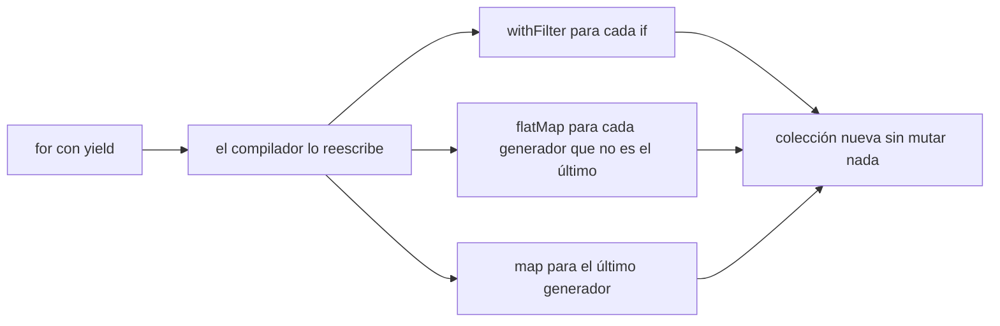
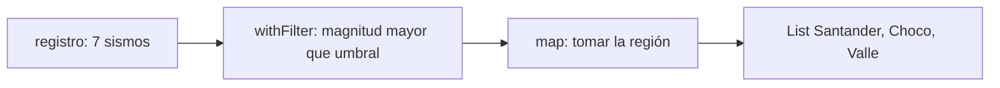
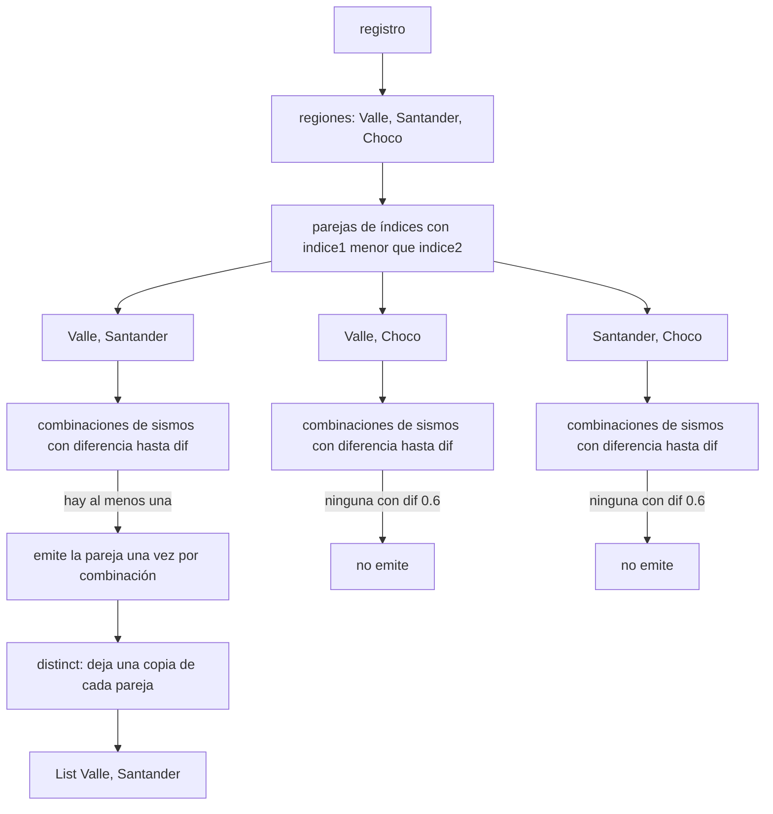
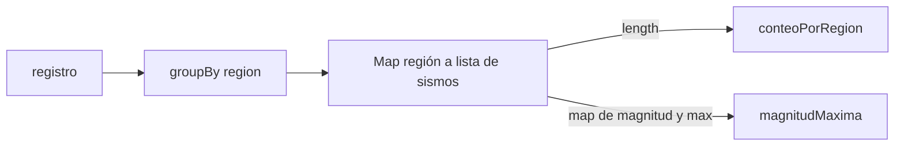
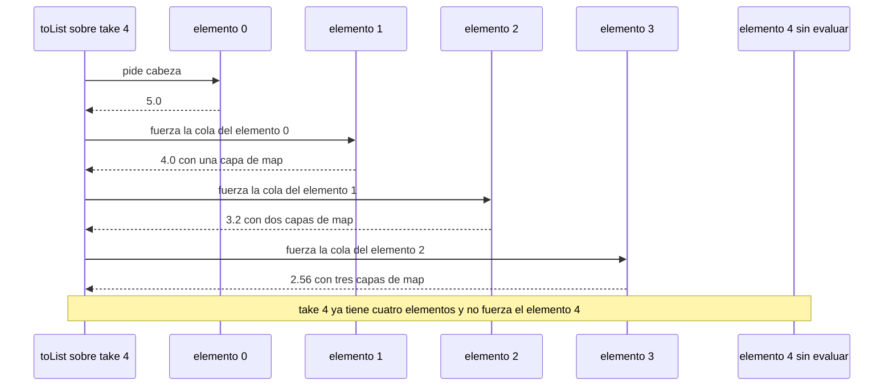
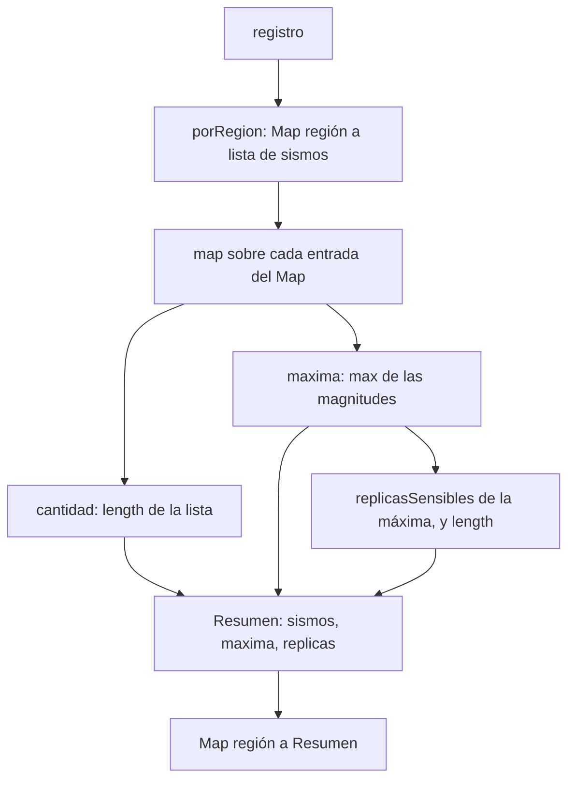

# Informe de proceso: consultas sobre un registro sísmico

Este informe explica, paso a paso, cómo se ejecuta cada función del taller, en qué operaciones se traduce cada expresión `for` que usamos y por qué la secuencia perezosa del punto 4 no agota la memoria aunque sea infinita.

## 0. Modelo de datos y registro de ejemplo

```scala
case class Fecha(anio: Int, mes: Int)
case class Sismo(fecha: Fecha, region: String, magnitud: Double, profundidad: Int)
type Registro = List[Sismo]
case class Resumen(sismos: Int, maxima: Double, replicas: Int)
```

En todas las trazas usamos el registro del enunciado. Para abreviar escribimos cada sismo como `región/magnitud`:

| # | Sismo (región/magnitud) |
|---|-------------------------|
| 1 | Valle/4.2 |
| 2 | Santander/5.1 |
| 3 | Valle/3.8 |
| 4 | Choco/6.0 |
| 5 | Santander/4.7 |
| 6 | Valle/5.3 |
| 7 | Choco/3.1 |

### Cómo traduce Scala una expresión `for`

El compilador no ejecuta el `for` como un ciclo: lo reescribe en llamadas a `withFilter`, `map` y `flatMap`. Las reglas que usaremos son:

| Forma del `for` | Se traduce en |
|-----------------|---------------|
| `for (x <- xs) yield e` | `xs.map(x => e)` |
| `for (x <- xs if p) yield e` | `xs.withFilter(x => p).map(x => e)` |
| `for (x <- xs; y <- ys) yield e` | `xs.flatMap(x => ys.map(y => e))` |
| `for (x <- xs; y <- ys if p) yield e` | `xs.flatMap(x => ys.withFilter(y => p).map(y => e))` |

Regla general: cada generador que **no es el último** se traduce en `flatMap`, el último en `map`, y cada `if` en un `withFilter`. `withFilter` es un `filter` que no construye una colección intermedia: el filtro y el `map` se aplican en una sola pasada. Cuando un generador tiene un patrón de tupla, como `(region, indice) <- ...`, Scala 2.13 agrega además un `withFilter` por el patrón que deja pasar todo; lo omitimos en las traducciones para no recargarlas.



---

## 1. Punto 1: consultas con expresiones `for`

### 1.1 `fuertes`

```scala
def fuertes(r: Registro, umbral: Double): List[String] =
  for {
    sismo <- r
    if sismo.magnitud > umbral
  } yield sismo.region
```

**Explicación.** Se recorre el registro de izquierda a derecha. Cada sismo cuya magnitud supera el umbral aporta su región al resultado. Como no se llama a `distinct`, las regiones repetidas se conservan, y como se recorre en orden, el resultado respeta el orden del registro.

**Traducción del `for`.**

```scala
r.withFilter(sismo => sismo.magnitud > umbral).map(sismo => sismo.region)
```

Una sola operación de filtro perezoso (`withFilter`) y una de transformación (`map`).

**Traza de `fuertes(registro, 5.0)`:**

| # | Sismo | ¿magnitud > 5.0? | Acción | Resultado parcial |
|---|-------|------------------|--------|-------------------|
| 1 | Valle/4.2 | no | se descarta | `List()` |
| 2 | Santander/5.1 | sí | se agrega `"Santander"` | `List(Santander)` |
| 3 | Valle/3.8 | no | se descarta | `List(Santander)` |
| 4 | Choco/6.0 | sí | se agrega `"Choco"` | `List(Santander, Choco)` |
| 5 | Santander/4.7 | no | se descarta | `List(Santander, Choco)` |
| 6 | Valle/5.3 | sí | se agrega `"Valle"` | `List(Santander, Choco, Valle)` |
| 7 | Choco/3.1 | no | se descarta | `List(Santander, Choco, Valle)` |

Resultado: `List("Santander", "Choco", "Valle")`, igual al del enunciado.



### 1.2 `enRegion`

```scala
def enRegion(r: Registro, region: String): List[Double] =
  for {
    sismo <- r
    if sismo.region == region
  } yield sismo.magnitud
```

**Explicación.** Es la misma estructura que `fuertes`, pero el filtro compara la región y lo que se produce es la magnitud.

**Traducción del `for`.**

```scala
r.withFilter(sismo => sismo.region == region).map(sismo => sismo.magnitud)
```

**Traza de `enRegion(registro, "Valle")`:** los sismos 1, 3 y 6 pasan el filtro y aportan `4.2`, `3.8` y `5.3`. Resultado: `List(4.2, 3.8, 5.3)`.
Para `"Amazonas"` ningún sismo pasa el filtro, el `map` no recibe elementos y el resultado es `List()`.

### 1.3 `paresCercanos`

```scala
def paresCercanos(r: Registro, dif: Double): List[(String, String)] = {
  val regiones = (for {
    sismo <- r
  } yield sismo.region).distinct
  (for {
    (region1, indice1) <- regiones.zipWithIndex
    (region2, indice2) <- regiones.zipWithIndex
    if indice1 < indice2
    sismo1 <- r if sismo1.region == region1
    sismo2 <- r if sismo2.region == region2
    if math.abs(sismo1.magnitud - sismo2.magnitud) <= dif
  } yield (region1, region2)).distinct
}
```

**Explicación.**

1. `regiones` es la lista de regiones sin repetir, en el orden de primera aparición (`distinct` conserva la primera ocurrencia). Para el registro de ejemplo es `List(Valle, Santander, Choco)`.
2. `regiones.zipWithIndex` le pone a cada región su posición. Los dos primeros generadores recorren todas las parejas de regiones, y la condición `indice1 < indice2` deja cada pareja **una sola vez** y descarta las parejas de una región consigo misma. Así, si sale `("Valle", "Choco")`, nunca sale `("Choco", "Valle")`.
3. Los dos generadores siguientes recorren los sismos de la primera región (`sismo1`) y los sismos de la segunda región (`sismo2`). El último `if` se queda con las combinaciones de sismos cuyas magnitudes difieren a lo sumo `dif`.
4. Por cada combinación de sismos que cumple, el `for` emite `(region1, region2)`. Si la pareja de regiones tiene varias combinaciones que cumplen, se emite **repetida**; el `distinct` final deja una sola copia, la primera.
5. Como los índices avanzan en orden, las parejas salen ordenadas según la primera aparición de cada región.

**Traducción del `for`** (cuatro generadores y tres `if`; los `if` se vuelven `withFilter`):

```scala
regiones.zipWithIndex.flatMap { case (region1, indice1) =>
  regiones.zipWithIndex
    .withFilter { case (region2, indice2) => indice1 < indice2 }
    .flatMap { case (region2, indice2) =>
      r.withFilter(sismo1 => sismo1.region == region1).flatMap { sismo1 =>
        r.withFilter(sismo2 => sismo2.region == region2)
          .withFilter(sismo2 => math.abs(sismo1.magnitud - sismo2.magnitud) <= dif)
          .map(sismo2 => (region1, region2))
      }
    }
}.distinct
```

Son tres `flatMap` (uno por cada generador que no es el último), un `map` (el último generador) y un `withFilter` por cada `if`. Cada `flatMap` concatena las listas que produce su cuerpo, de modo que las emisiones salen ordenadas por `(indice1, indice2)`, y todas las de una misma pareja de regiones quedan seguidas.

**Traza de `paresCercanos(registro, 0.6)`.** Aquí `regiones = List(Valle, Santander, Choco)`:

| indice1 | indice2 | Pareja | Combinaciones de sismos que cumplen `<= 0.6` | Emisiones |
|---------|---------|--------|----------------------------------------------|-----------|
| 0 | 1 | Valle, Santander | Valle 4.2 con Santander 4.7 (0.5) y Valle 5.3 con Santander 5.1 (0.2). Valle 5.3 con Santander 4.7 cae justo en el borde (la resta es 0.6) y en `Double` da `0.5999999999999996`, así que también cuenta | `(Valle, Santander)` varias veces |
| 0 | 2 | Valle, Choco | ninguna: la menor diferencia es 0.7 (Valle 5.3 con Choco 6.0, o Valle 3.8 con Choco 3.1) | ninguna |
| 1 | 2 | Santander, Choco | ninguna: la menor diferencia es 0.9 (Santander 5.1 con Choco 6.0) | ninguna |
| resto | resto | parejas con `indice1 >= indice2` | se descartan por el primer `if`, sin mirar los sismos | ninguna |

Antes del `distinct`, la lista tiene la pareja `(Valle, Santander)` repetida (al menos dos veces) y nada más. El `distinct` deja `List(("Valle", "Santander"))`, que coincide con el enunciado.

Con `dif = 1.0` las tres parejas tienen al menos una combinación que cumple (`0.2`, `0.7` y `0.9` son menores o iguales que `1.0`). El resultado queda en el orden de los índices: `List((Valle, Santander), (Valle, Choco), (Santander, Choco))`. Con `dif = 0.1` ninguna combinación cumple (la menor diferencia entre regiones distintas es `0.2`) y el resultado es `List()`.



---

## 2. Punto 2: agrupar con mapas

```scala
def porRegion(r: Registro): Map[String, List[Sismo]] =
  r.groupBy(_.region)

def conteoPorRegion(r: Registro): Map[String, Int] =
  porRegion(r).map { case (region, sismos) => region -> sismos.length }

def magnitudMaxima(r: Registro): Map[String, Double] =
  porRegion(r).map { case (region, sismos) =>
    region -> sismos.map(_.magnitud).max
  }
```

### 2.1 `porRegion`

`groupBy(_.region)` recorre el registro una sola vez, de izquierda a derecha. Para cada sismo calcula su llave (la región) y lo agrega al final de la lista de esa llave. Dentro de cada región los sismos quedan en el mismo orden relativo del registro.

**Traza sobre el registro de ejemplo:**

| Paso | Sismo | Llave | Estado del mapa después del paso |
|------|-------|-------|----------------------------------|
| 1 | Valle/4.2 | Valle | `Valle -> [4.2]` |
| 2 | Santander/5.1 | Santander | `Valle -> [4.2]`, `Santander -> [5.1]` |
| 3 | Valle/3.8 | Valle | `Valle -> [4.2, 3.8]`, `Santander -> [5.1]` |
| 4 | Choco/6.0 | Choco | `Valle -> [4.2, 3.8]`, `Santander -> [5.1]`, `Choco -> [6.0]` |
| 5 | Santander/4.7 | Santander | `Valle -> [4.2, 3.8]`, `Santander -> [5.1, 4.7]`, `Choco -> [6.0]` |
| 6 | Valle/5.3 | Valle | `Valle -> [4.2, 3.8, 5.3]`, `Santander -> [5.1, 4.7]`, `Choco -> [6.0]` |
| 7 | Choco/3.1 | Choco | `Valle -> [4.2, 3.8, 5.3]`, `Santander -> [5.1, 4.7]`, `Choco -> [6.0, 3.1]` |

(En la tabla cada lista se abrevia a las magnitudes de sus sismos.) Una región que no está en el registro nunca recibe llave, así que no aparece en el mapa. Con el registro vacío no se crea ninguna llave y el resultado es `Map()`.

### 2.2 `conteoPorRegion` y `magnitudMaxima`

Las dos funciones parten de `porRegion` y transforman **el valor** de cada entrada: `Map.map` recibe pares `(llave, valor)` y devuelve pares, y por eso el resultado vuelve a ser un `Map`.

**Traza de `conteoPorRegion(registro)`:**

| Entrada de `porRegion` | Transformación | Entrada resultante |
|------------------------|----------------|--------------------|
| `Valle -> [4.2, 3.8, 5.3]` | `length` | `Valle -> 3` |
| `Santander -> [5.1, 4.7]` | `length` | `Santander -> 2` |
| `Choco -> [6.0, 3.1]` | `length` | `Choco -> 2` |

**Traza de `magnitudMaxima(registro)`:**

| Entrada de `porRegion` | Magnitudes (`map(_.magnitud)`) | `max` | Entrada resultante |
|------------------------|--------------------------------|-------|--------------------|
| `Valle -> ...` | `[4.2, 3.8, 5.3]` | 5.3 | `Valle -> 5.3` |
| `Santander -> ...` | `[5.1, 4.7]` | 5.1 | `Santander -> 5.1` |
| `Choco -> ...` | `[6.0, 3.1]` | 6.0 | `Choco -> 6.0` |

`max` solo se llama sobre listas no vacías: una llave existe únicamente si al menos un sismo la produjo, así que nunca se evalúa `max` sobre una lista vacía.



---

## 3. Punto 3: consultas seguras

```scala
def conteoSeguro(r: Registro): Map[String, Int] =
  conteoPorRegion(r).withDefaultValue(0)

def maximaDe(r: Registro, region: String): Option[Double] =
  magnitudMaxima(r).get(region)

def regionMasActiva(r: Registro): Option[String] =
  if (r.isEmpty) None
  else {
    val conteos = conteoPorRegion(r)
    val (masActiva, _) = conteos.minBy { case (region, conteo) =>
      (-conteo, region)}
    Some(masActiva)
  }
```

### 3.1 `conteoSeguro`

`withDefaultValue(0)` envuelve el mapa en otro que, al pedir una llave que no tiene, responde `0` en vez de lanzar `NoSuchElementException`. Las llaves que sí existen se responden igual que antes.

**Traza:**
- `conteoSeguro(registro)("Valle")`: la llave existe, devuelve `3`.
- `conteoSeguro(registro)("Amazonas")`: la llave no existe, se usa el valor por defecto y devuelve `0`.

### 3.2 `maximaDe`

`Map.get` devuelve `Some(valor)` si la llave existe y `None` si no. Como en `magnitudMaxima` solo existen las regiones con sismos, `None` significa exactamente que no hay registros de esa región.

**Traza:** `maximaDe(registro, "Choco")` es `Some(6.0)` y `maximaDe(registro, "Amazonas")` es `None`.

### 3.3 `regionMasActiva`

1. Si el registro está vacío, el resultado es `None` y no se calcula nada más.
2. Si no, `conteos` es el mapa de conteos: `Map(Valle -> 3, Santander -> 2, Choco -> 2)`.
3. `minBy` recorre las entradas y se queda con la que tiene la **menor** llave compuesta `(-conteo, region)`. Con el signo menos, el mayor conteo da la menor primera componente. Entre regiones con el mismo conteo decide la segunda componente, el orden alfabético de la región.
4. El patrón `val (masActiva, _)` extrae el nombre de la región de la entrada ganadora, y `Some(masActiva)` lo envuelve.

**Traza sobre el registro de ejemplo:**

| Entrada | Llave `(-conteo, region)` |
|---------|---------------------------|
| (Valle, 3) | (-3, Valle) |
| (Santander, 2) | (-2, Santander) |
| (Choco, 2) | (-2, Choco) |

La menor llave es `(-3, Valle)`, luego el resultado es `Some("Valle")`. Si Valle no existiera, las dos entradas restantes empatan en conteo y ganaría `(-2, Choco)` sobre `(-2, Santander)`, porque "Choco" es alfabéticamente anterior.

---

## 4. Punto 4: réplicas perezosas

```scala
def redondear(x: Double): Double = Math.round(x * 100.0) / 100.0

def replicas(magnitud: Double): LazyList[Double] =
  magnitud #:: replicas(magnitud * 0.8).map(redondear)

def replicasSensibles(magnitud: Double, minimo: Double): List[Double] =
  replicas(magnitud).takeWhile(_ > minimo).map(redondear).toList
```

### 4.1 Cómo se evalúa `replicas`

El operador `#::` construye una celda de `LazyList` con dos partes: la **cabeza**, que aquí es `magnitud` (ya calculada), y la **cola**, que se recibe **por nombre**: es una expresión guardada que no se evalúa hasta que alguien la pide. Una vez evaluada, el resultado se guarda (memoización) y no se vuelve a calcular.

La cola de `replicas(m)` es `replicas(m * 0.8).map(redondear)`. Como `LazyList.map` también es perezoso, esa cola es otra secuencia perezosa que solo calcula un elemento cuando se le pide. Por la forma de la recursión, el elemento de la posición `n` pasa por `n` capas de `map(redondear)`, una por cada nivel de recursión que atravesó. Redondear un valor ya redondeado no lo cambia, así que las capas adicionales no alteran el resultado.

### 4.2 Traza de `replicas(5.0).take(4).toList`

```scala
replicas(5.0)
→ 5.0 #:: <promesa: replicas(4.0).map(redondear)>   // celda 0, cola sin evaluar
```

`take(4)` no calcula nada por sí mismo: devuelve otra secuencia perezosa que recordará "tomar cuatro". El cálculo ocurre cuando `toList` pide los elementos:

| Elemento | Qué se evalúa | Valor base (sin redondear) | Capas de `map(redondear)` | Valor devuelto |
|----------|---------------|----------------------------|---------------------------|----------------|
| 0 | la cabeza de `replicas(5.0)` | 5.0 | 0 | `5.0` |
| 1 | se fuerza la cola: `replicas(4.0)` y su capa de `map` | 4.0 | 1 | `4.0` |
| 2 | se fuerza la cola de la anterior: `replicas(3.2)` y sus capas | 3.2 | 2 | `3.2` |
| 3 | se fuerza la cola de la anterior: `replicas(2.56...)` y sus capas | 2.5600000000000005 | 3 | `2.56` |
| 4 | **no se evalúa**: es la promesa `replicas(2.048...)` pendiente | | | |

Después del cuarto elemento, `take(4)` ya tiene lo que necesita y cierra la lista sin pedir la cola. La promesa del siguiente nivel queda sin evaluar y se descarta. El resultado es `List(5.0, 4.0, 3.2, 2.56)`.



### 4.3 Traza de `replicasSensibles(5.0, 3.0)`

`takeWhile(_ > 3.0)` pide elementos uno a uno y se detiene en el primero que no cumple. Después `map(redondear)` redondea cada elemento conservado, y `toList` materializa el resultado:

| Elemento | Valor | ¿> 3.0? | Acción |
|----------|-------|---------|--------|
| 0 | 5.0 | sí | se conserva |
| 1 | 4.0 | sí | se conserva |
| 2 | 3.2 | sí | se conserva |
| 3 | 2.56 | no | **se detiene**; no se fuerza el elemento 4 |

Resultado: `List(5.0, 4.0, 3.2)`. Para `replicasSensibles(2.0, 3.0)` el primer elemento (`2.0`) ya no supera el mínimo, `takeWhile` se detiene de inmediato y el resultado es `List()`.

Observación: el `map(redondear)` de `replicasSensibles` sirve sobre todo para redondear el primer elemento, que `replicas` entrega tal cual `magnitud`. Para las magnitudes del registro (con un decimal) el redondeo no cambia nada.

### 4.4 Por qué la secuencia infinita no agota la memoria

1. **La secuencia infinita nunca existe en memoria.** Cada celda se construye solo cuando alguien la pide. El número de celdas reales es el de elementos pedidos más la promesa pendiente.
2. **La promesa pendiente es pequeña.** Guarda lo necesario para calcular el siguiente valor (una magnitud, un `Double`, y la función `redondear`), sin importar cuántas réplicas faltarían.
3. **`take(n)` y `takeWhile` cortan el recorrido.** `take(4)` fuerza cuatro elementos y `takeWhile` fuerza los que cumplen la condición más el primero que no cumple (es el mínimo necesario para saber que debe parar). Ninguna de las dos pide el resto.
4. **El resultado final es una `List` finita**, construida con `toList` solo con los elementos pedidos. La secuencia perezosa intermedia no queda referenciada y el recolector de basura puede liberarla.
5. **Contraste con una definición no perezosa.** Con una `List` o con una función recursiva estricta, construir la secuencia exigiría calcular `replicas(magnitud * 0.8)` antes de devolver la celda, y eso a su vez pediría la siguiente, sin fin: el programa se colgaría. La pereza es lo que rompe esa cadena.

Dos precauciones. Primero, por la memoización, si alguien guarda la cabeza (`val xs = replicas(5.0)`) y luego recorre un millón de elementos, esas celdas quedan retenidas: la memoria crece con los elementos **evaluados**, no con la longitud infinita. Segundo, en esta definición el elemento `n` atraviesa `n` capas de `map`, así que forzar los primeros `n` elementos cuesta del orden de `n` al cuadrado operaciones. Para `replicasSensibles` esto no importa, porque la magnitud cae por debajo de cualquier mínimo razonable en pocas decenas de pasos.

---

## 5. Punto 5: informe combinado

```scala
def informe(r: Registro, minimo: Double): Map[String, Resumen] = {
  val grupos = porRegion(r)

  val resultado = for {
    (region, listaSismos) <- grupos
  } yield {
    val cantidad = listaSismos.length
    val maxima = listaSismos.map(_.magnitud).max
    val totalReplicas = replicasSensibles(maxima, minimo).length
    region -> Resumen(cantidad, maxima, totalReplicas)
  }
  resultado
}
```

**Explicación.** `grupos` es el mapa de región a lista de sismos. Para cada entrada se calculan tres datos: la cantidad de sismos, la magnitud máxima (la del sismo más fuerte de la región) y cuántas réplicas sensibles se esperan de ese sismo. Con ellos se arma el `Resumen`, y el bloque devuelve el par `region -> Resumen`.

**Traducción del `for`.** El generador recorre un `Map` con un patrón de tupla y no hay más generadores, así que se traduce en un único `map`:

```scala
grupos.map { case (region, listaSismos) =>
  val cantidad = listaSismos.length
  val maxima = listaSismos.map(_.magnitud).max
  val totalReplicas = replicasSensibles(maxima, minimo).length
  region -> Resumen(cantidad, maxima, totalReplicas)
}
```

Como el bloque produce un par `llave -> valor`, `Map.map` devuelve un `Map[String, Resumen]`.

**Traza de `informe(registro, 3.0)`.** Para cada grupo se calculan las réplicas del sismo más fuerte, redondeadas a dos decimales, y se cuentan las que superan `3.0`:

| Región | Sismos del grupo | `cantidad` | `maxima` | Réplicas generadas | `totalReplicas` |
|--------|------------------|-----------|----------|--------------------|-----------------|
| Valle | 4.2, 3.8, 5.3 | 3 | 5.3 | 5.3, 4.24, 3.39, 2.71 | 3 |
| Santander | 5.1, 4.7 | 2 | 5.1 | 5.1, 4.08, 3.26, 2.61 | 3 |
| Choco | 6.0, 3.1 | 2 | 6.0 | 6.0, 4.8, 3.84, 3.07, 2.46 | 4 |

(En cada fila `takeWhile` se detiene en la primera réplica que no supera `3.0`: la cuarta en Valle y Santander, la quinta en Choco.)

Resultado: `Map("Valle" -> Resumen(3, 5.3, 3), "Santander" -> Resumen(2, 5.1, 3), "Choco" -> Resumen(2, 6.0, 4))`, igual al del enunciado. Con el registro vacío, `grupos` es `Map()`, el `for` no tiene entradas y el resultado es `Map()`.



---

## 6. Resumen: en qué se traduce cada `for` y por qué la secuencia perezosa es segura

### 6.1 Expresiones `for` usadas

| Función | Expresión `for` | Se traduce en |
|---------|-----------------|---------------|
| `fuertes` | un generador y un `if` | `withFilter` y `map` |
| `enRegion` | un generador y un `if` | `withFilter` y `map` |
| `paresCercanos` (cálculo de `regiones`) | un generador | `map` |
| `paresCercanos` (pares) | cuatro generadores y tres `if` | tres `flatMap`, tres `withFilter` y un `map` |
| `informe` | un generador con patrón de tupla sobre un `Map` | un `map` sobre el `Map` (con `withFilter` trivial en Scala 2.13) |

En ningún caso se usa una variable mutable ni un ciclo: cada `for` produce una colección nueva a partir de otra.

### 6.2 La secuencia perezosa del punto 4

`replicas` es una secuencia infinita, pero no agota la memoria porque (1) cada celda se construye solo cuando se pide, (2) la cola pendiente es una promesa de tamaño constante, (3) `take` y `takeWhile` dejan de pedir en cuanto tienen lo necesario, y (4) lo que se devuelve al final es una `List` finita con solo los elementos pedidos. La memoria que se usa es proporcional al número de elementos **evaluados**, nunca a la longitud de la secuencia.

